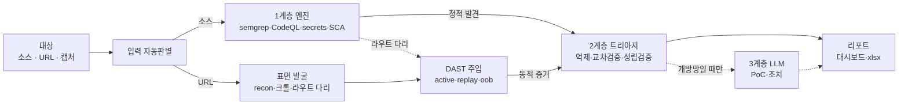

# OKRA — SAST + DAST 통합 진단기

## 1. 개요

소스 코드를 주면 정적 분석(SAST), 살아있는 URL을 주면 동적 점검(DAST). 둘 다 주면 **정적에서 찾은 의심 지점을 실제로 쏴서 확증**까지 한다.

핵심은 세 가지다.
- **폐쇄망 자립** — 인터넷·AI 없이 도구 혼자 끝까지 돈다. 설치 번들(tar)로 묶어 반입한다.
- **계층형 트리아지** — 스캐너가 뱉은 의심을 확정 / 오탐 / 검토필요로 자동 분류해 "사람이 다시 볼 양"을 줄인다.
- **범용성** — 대상이 소스든 URL이든 캡처든 같은 명령 하나로 받는다.

## 2. 설명



대상을 넣으면 종류를 자동 판별한다. 1계층이 룰로 훑고 표면을 발굴하면, DAST가 실제로 찔러보고, 2계층이 정탐/오탐을 가른다. 인터넷과 LLM이 있으면 3계층이 PoC까지 붙인다.

**1계층 — 찾기 (오프라인, 외부통신 0)**
룰 기반 스캐너 4종이 소스를 훑는다. `semgrep`(패턴), `CodeQL`(데이터 흐름/taint), `secrets`(평문 비밀번호·API키·주민번호·카드번호, 값은 마스킹), `SCA`(의존성 CVE). 여기까지 외부 통신이 0이라 폐쇄망에선 이 계층만으로 점검이 끝난다.

**2계층 — 거르기 (오프라인 판정)**
1계층의 "의심"을 실제 취약 여부로 판정한다. 억제(명백한 오탐 제거), 교차검증(패턴 엔진 오탐을 taint로 정정), 성립검증(취약점마다 전제조건을 증거와 대조). 결과는 **확정 / 오탐 / 검토필요**. 이것도 인터넷 없이 된다.

**3계층 — 심화 (개방망 또는 로컬 LLM일 때만)**
확정된 취약점에 복붙 가능한 PoC와 조치를 붙인다. LLM이 없으면 실행되지 않아 폐쇄망에서 안전하다.

**사이를 잇는 두 축**
- **표면 발굴** — 하위도메인 열거, URL 크롤, 그리고 **라우트 다리**. 소스의 라우트 정의(`@GetMapping`·Flask·Express 등)를 뽑아 DAST에 넘긴다. SPA나 인증 뒤에 숨어 크롤로는 못 찾는 엔드포인트를 이렇게 연다.
- **DAST** — 살아있는 대상에 payload를 주입해 SQLi·XSS·IDOR 등을 라이브로 확증한다. 정적 의심을 실증으로 올린다.

결과는 `out/<이름>/`에 대시보드(`index.html`), 엑셀 워크북(Endpoints·Recon·Exposure), `results.json`으로 나온다.

## 3. 옵션 설명

깊이는 **모드 하나**로 고른다. 능동 DAST(패킷 전송)는 **인가받은 대상에만** 쓴다.

| 명령 | 하는 일 | 하위도메인 정찰 | LLM |
|---|---|:---:|:---:|
| `./okra <URL> --active` | 능동 DAST(GET만, 안전) + 오프라인 트리아지 | ✅ | ✗ |
| `./okra <URL> --full` | `--active` + **상태변경(POST/PUT) 점검** + LLM 심화 | ✅ | ✅ (설정 시) |
| `./okra <URL> --domain` | `--active`를 이 도메인 하나만 | ✗ | ✗ |

- 플래그가 없으면 **안전 패시브**(능동 프로브 0, 비파괴)다.
- `--active`는 GET만 찔러 안전하고, `--full`은 상태변경 엔드포인트까지 점검한다. 삭제·결제·초기화 같은 파괴적 동사는 어느 모드에서도 제외된다.

**입력 3종**은 자동 판별된다.

| 넣는 것 | 인식 | 하는 일 |
|---|---|---|
| 폴더 | 소스 | SAST |
| `http(s)://…` | 라이브 URL | DAST |
| 파일 (Burp XML / HAR) | 캡처 | 패시브 분석 + replay (패킷 0) |

셋을 같이 주면 통합 스캔 + SAST↔캡처 상관분석까지 한 번에 돈다.

**자주 쓰는 옵션**
- `--deep` — CodeQL taint 엔진 추가(흐름 취약점)
- `--no-recon` / `--recon-passive` — 하위도메인 정찰 끄기 / crt.sh·Wayback·DoH 패시브 소스까지
- `--cookie 'SESSION=..'` , `-H 'Authorization: Bearer ..'` — 인증 세션·헤더
- `--oob` — blind SSRF/XXE/RCE 콜백 확증 / `--insecure` — 자기서명 인증서 대상
- 로그인 자동화: `SAST_LOGIN_USER/PASS`(2계정 주면 IDOR 확정). 자격증명은 환경변수로만, 로그엔 마스킹.

```bash
./okra ./myapp                              # 소스 정적 분석 (폐쇄망, 패킷 0)
./okra https://app.example.com --active     # URL 능동 점검 + 정찰
./okra ./myapp https://app.example.com --full   # 소스+URL 통합, LLM 심화까지
./okra ./capture.har --active               # 캡처 replay (실요청 기반)
```

폐쇄망 반입: 온라인에서 `./provision.sh`로 엔진·룰·DB를 `tools/`에 모으고 `./package.sh`로 묶어, 폐쇄망에서 풀고 `SAST_TOOLS_DIR`만 잡으면 된다.

## 4. 향후 계획

- **Discover 스테이지 통합** — 흩어진 recon·크롤·라우트다리·캡처를 한 스테이지로 묶어 오케스트레이터 정리(진행 중인 구조 리빌딩)
- **라우트 다리 확장** — NestJS·Spring 클래스프리픽스 등 프레임워크 커버 확대 + 파라미터 타입추론으로 페이로드 정밀화
- **소스 없는 블랙박스용 SPA 크롤** — 라우트 다리는 소스가 필요하니, 소스 없는 대상용 휴리스틱 발굴
- **APK/IPA 마이너** — `--app <apk>`로 모바일 하이브리드 앱의 엔드포인트·키·봉투 템플릿 추출
- **대시보드 시각화** — 라우트 다리·replay·상관분석 결과를 대시보드에 반영
